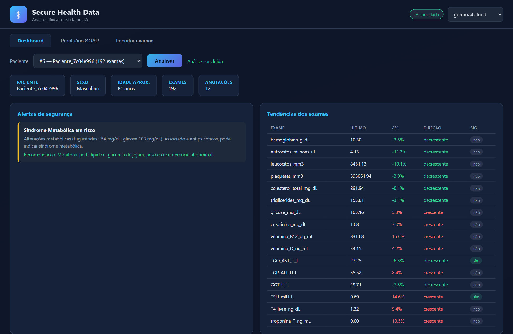
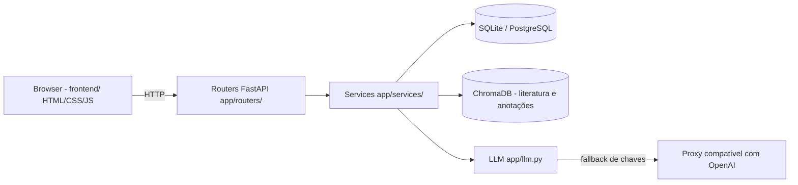
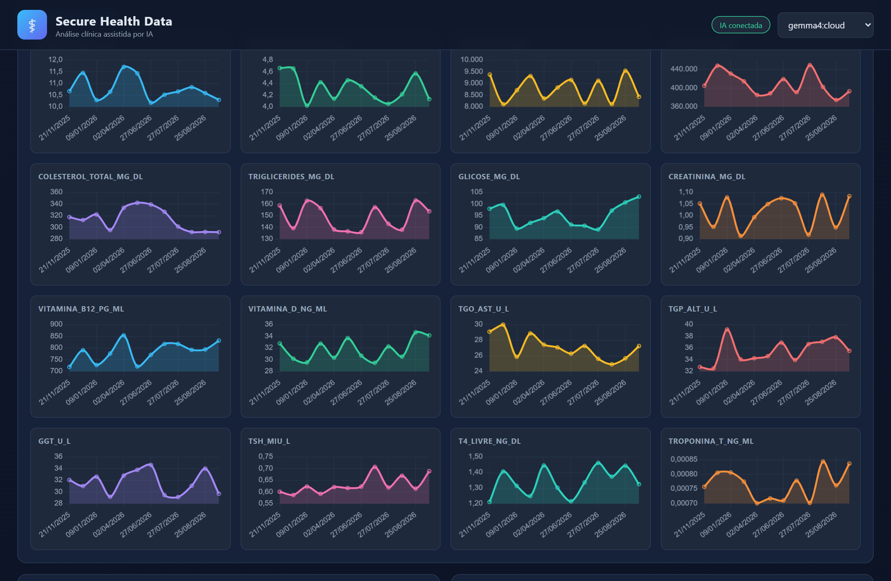
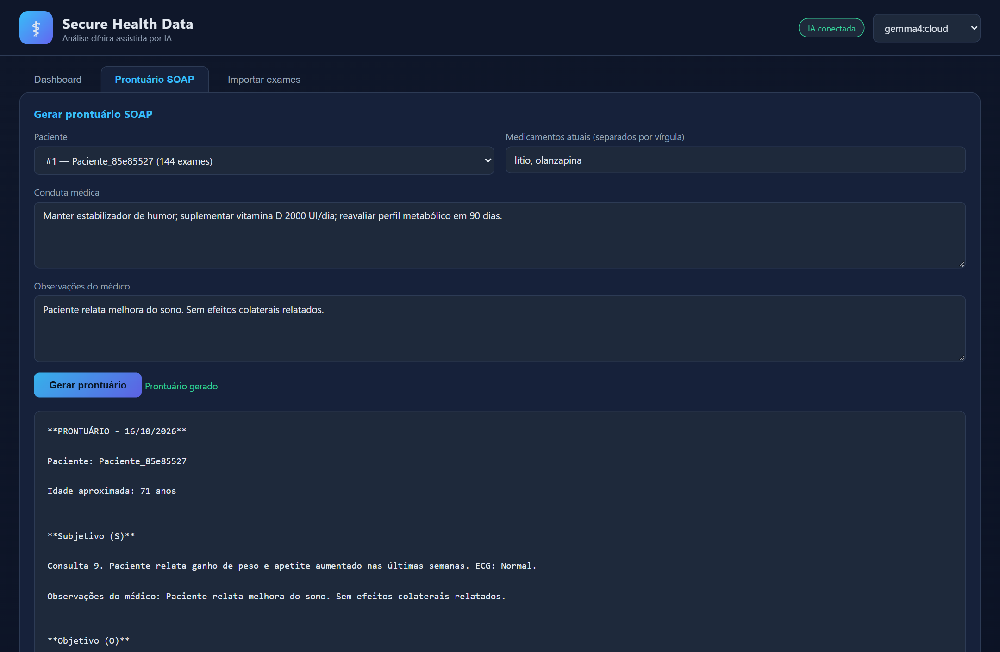
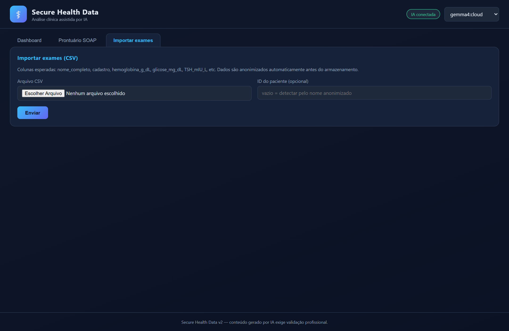
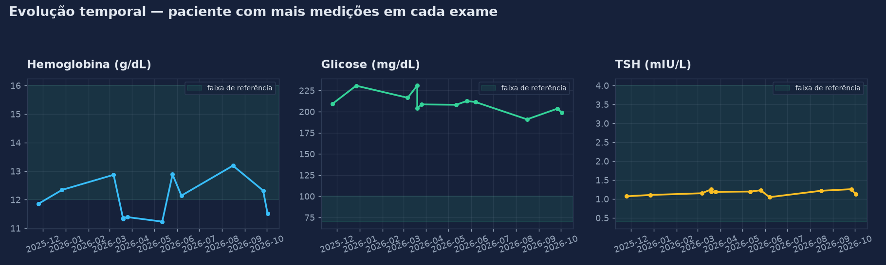
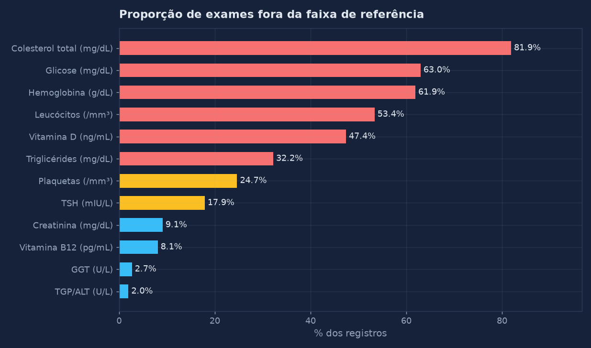
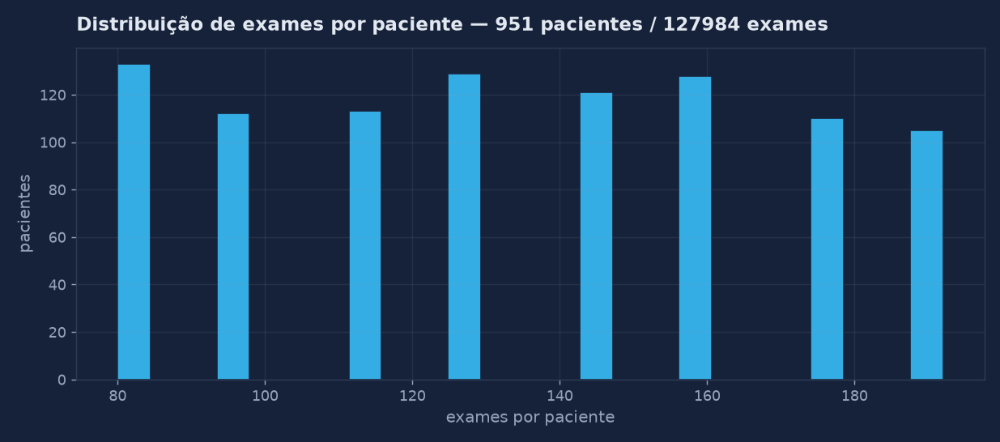

# Secure Health Data

Plataforma de **análise clínica assistida por IA** para dados de saúde: importação anonimizada de exames laboratoriais, detecção de tendências estatísticas, alertas de segurança clínica, recuperação de literatura (RAG), geração de análise com LLM e prontuário SOAP — tudo em uma interface web.



---

## Sumário

- [Funcionalidades](#funcionalidades)
- [Arquitetura](#arquitetura)
- [Como executar](#como-executar)
- [Configuração (.env)](#configuração-env)
- [Interface](#interface)
- [Resultados e análises](#resultados-e-análises)
- [API](#api)
- [Estrutura do projeto](#estrutura-do-projeto)
- [Segurança](#segurança)

## Funcionalidades

- **Importação de exames (CSV)** com anonimização automática (hash SHA-256 no nome, remoção de CPF/contatos, data de nascimento reduzida ao ano).
- **Análise de tendências**: estatísticas descritivas + regressão linear com teste de significância (p < 0,05) por tipo de exame.
- **Alertas de segurança clínica**: agranulocitose/clozapina, síndrome metabólica, nefrotoxicidade/lítio, deficiência de vitamina D e B12, interação IMAO + ISRS.
- **RAG (ChromaDB)**: indexação de literatura `.txt` e anotações clínicas recuperação por similaridade.
- **Análise com LLM** via proxy compatível com OpenAI, com **fallback automático de chaves**: se uma chave falhar (401/429/5xx), a próxima da lista é tentada.
- **Prontuário SOAP** gerado a partir de exames, tendências, alertas, literatura e conduta do médico.
- **Interface web** com gráficos de evolução temporal (Chart.js), sem necessidade de Node.js.

## Arquitetura



- **Backend** (`app/`): `routers/` (HTTP) → `services/` (regra de negócio) → `database.py` / `rag.py` / `llm.py` (infraestrutura). Adicionar endpoint = criar função no router correspondente; adicionar regra clínica = novo módulo em `services/`.
- **Frontend** (`frontend/`): HTML/JS/CSS puro servido pelo próprio FastAPI em `/` — zero build step.
- **Dados**: SQLite local por padrão; PostgreSQL automaticamente quando `DATABASE_URL` aponta para Postgres (usado no Docker).

## Como executar

### 1 comando (recomendado, sem Docker)

**Windows (PowerShell):**

```powershell
.\run.ps1
```

ou simplesmente `run.bat` pelo prompt de comandos.

**Linux / macOS:**

```bash
sh run.sh
```

O script cria o ambiente virtual (usa **uv** se disponível, senão **pip**), copia `.env.example` → `.env` se necessário, popula o banco com dados sintéticos e sobe a aplicação.

Abra **http://localhost:8000**

### Com uv

```bash
uv sync
uv run scripts/seed.py
uv run uvicorn app.main:app --port 8000
```

### Com pip

```bash
python -m venv .venv
# Windows:
.venv\Scripts\activate
# Linux/macOS:
source .venv/bin/activate

pip install -r requirements.txt
python scripts/seed.py
uvicorn app.main:app --port 8000
```

### Com Docker (Postgres + API)

```bash
cp .env.example .env   # apenas se ainda não existir .env
docker compose up --build
```

O `docker-compose` sobe PostgreSQL 16 + a API em http://localhost:8000, executando o seed automaticamente.

### Primeiro acesso

1. Abra http://localhost:8000
2. Escolha um paciente no Dashboard e clique em **Analisar**
3. Para ativar a IA, preencha `LLM_BASE_URL` e `OLLAMA_API_KEY` no `.env` e reinicie (veba abaixo)

## Configuração (.env)

O arquivo `.env` é criado automaticamente a partir do `.env.example` e é **ignorado pelo Git**.

| Variável | Descrição | Padrão |
|---|---|---|
| `LLM_BASE_URL` | URL do proxy compatível com OpenAI (ex.: `https://proxy.exemplo.com/v1`) | vazio (IA desativada) |
| `LLM_MODEL` | Modelo padrão | `gemma4:cloud` |
| `OLLAMA_AVAILABLE_MODELS` | Modelos disponíveis no seletor da interface (separados por vírgula) | `gemma4:cloud,gpt-oss:120b,nemotron-3-ultra` |
| `OLLAMA_API_KEY` | **Lista de chaves** separadas por vírgula | vazio |
| `DATABASE_URL` | Banco de dados | `sqlite:///./data/secure_health.db` |
| `CHROMA_PERSIST_DIR` | Diretório do índice vetorial | `./rag_index` |
| `LITERATURA_PATH` | Pasta com `.txt` de literatura para o RAG | `./data/literatura` |
| `CLINICAL_ALERTS_ENABLED` | Habilita alertas clínicos | `true` |

### Fallback de chaves

`OLLAMA_API_KEY` aceita várias chaves em lista:

```env
OLLAMA_API_KEY=chave_1,chave_2,chave_3
```

Na chamada à IA, as chaves são tentadas **em ordem**. Se uma falhar por autenticação, rate limit ou erro do servidor, a próxima é usada automaticamente. Somente se todas falharem a requisição retorna erro — e a interface exibe o aviso sem quebrar (tendências e alertas continuam disponíveis).

### Literatura para o RAG

Crie `data/literatura/`, coloque os arquivos `.txt` e indexe:

```bash
python scripts/popular_rag.py
```

## Interface

**Dashboard** — seleção de paciente, alertas, tabela de tendências e gráficos de evolução:



**Prontuário SOAP** — conduta e observações do médico viram um prontuário estruturado (S/O/A/P):



**Importar exames** — upload de CSV com anonimização automática:



## Resultados e análises

O `scripts/seed.py` transforma o dataset sintético (`data/synthetic_patient_data_1000.csv`) em uma série temporal: **951 pacientes, ~128 mil exames** em 16 tipos de exame, com ruído de ±10% e medições distribuídas ao longo de 1 ano (5–12 medições por paciente).

**Evolução temporal com faixas de referência:**



**Exames fora da faixa de referência:**



**Distribuição de exames por paciente:**



## API

Documentação interativa: **http://localhost:8000/docs** (Swagger)

| Método | Rota | Descrição |
|---|---|---|
| GET | `/api/health` | Status da API |
| GET | `/api/config` | Modelos, estado da IA e flags |
| GET | `/api/pacientes` | Lista de pacientes anonimizados |
| GET | `/api/pacientes/{id}` | Paciente com exames e anotações |
| POST | `/api/upload_exame` | Importa CSV (multipart: `file`, `paciente_id?`) |
| POST | `/api/analisar` | Tendências + alertas + RAG + análise LLM |
| POST | `/api/gerar_prontuario` | Gera prontuário SOAP e registra evolução |

Exemplo:

```bash
curl -X POST http://localhost:8000/api/analisar \
  -H "Content-Type: application/json" \
  -d '{"paciente_id": 1, "observacoes_medico": "fadiga persistente"}'
```

Resposta inclui `tendencias`, `alertas`, `serie_temporal` (para gráficos), `literatura_usada`, `analise_llm` e — se a IA estiver indisponível — `erro_llm` com o motivo.

## Estrutura do projeto

```
├── app/
│   ├── main.py            # App FastAPI (lifespan, routers, frontend estático)
│   ├── config.py          # Settings via .env (pydantic-settings)
│   ├── database.py        # Engine SQLite/Postgres + sessões
│   ├── models.py          # Models SQLAlchemy (Paciente, Exame, AnotacaoClinica)
│   ├── schemas.py         # Schemas Pydantic (request/response)
│   ├── llm.py             # Cliente LLM com fallback de chaves
│   ├── rag.py             # ChromaDB (literatura + anotações)
│   ├── routers/           # Endpoints HTTP
│   └── services/          # Regra de negócio (análise, alertas, prontuário...)
├── frontend/              # Interface HTML/CSS/JS (servida em /)
├── scripts/
│   ├── seed.py            # Popula o banco com dados sintéticos
│   └── popular_rag.py     # Indexa literatura
├── data/                  # Dataset CSV e banco SQLite
├── docs/                   # Screenshots e gráficos do README
├── run.ps1 / run.bat / run.sh   # Execução em 1 comando
├── Dockerfile / docker-compose.yml
├── pyproject.toml         # uv sync
└── requirements.txt       # pip install -r
```

## Segurança

- **Anonimização na entrada**: nome → hash SHA-256 truncado, CPF e contato removidos, nascimento reduzido ao ano.
- **Credenciais fora do repositório**: o `.env` está no `.gitignore`; o `.env.example` contém apenas placeholders. **Nunca commite chaves no código.** Se uma chave já foi exposta em commits antigos, revogue-a no provedor — apagar do histórico não basta.
- **Banco**: SQLite local por padrão (nenhum dado sai da máquina); Postgres apenas quando configurado.
- **Uso clínico**: saídas geradas por IA são sugestões para revisão profissional — o prontuário exige validação do responsável técnico.

---

Desenvolvido com FastAPI, SQLAlchemy, ChromaDB, pandas/scipy e Chart.js.
